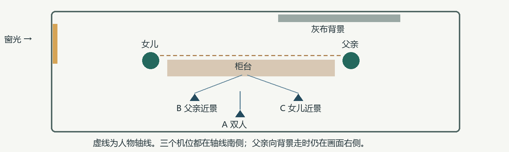

# 现场导演工作页

按需要查看亲密关系、悬念、轴线、动画表演、声音剪辑、28 秒《交班》分镜、可灵提示词与验收。

## 07  亲密关系怎样拍

下面的选择属于分镜方案。情绪相同，只要观众知道的事或站在谁的一边不同，拍法就会改变。

| 叙事任务 | 景别、机位与站位 | 光、表演、声音与剪点 |
|---|---|---|
| 重逢前的试探 | 先用平视双人中景；两人隔着桌角，脸都可见。对方叫出旧称呼后，才切近听者。 | 窗侧柔光能看见眼神。说话人故意轻快，听者先看杯子再抬眼。杯底触桌后暂留室内底噪。 |
| 掩饰一份愧疚 | 把说话人置于前景侧面，听者留在后景同框。摄影机不抢着转向说话者，等他的手停。 | 台灯照着两人之间尚未交出的东西。台词“挺好的”在吸气后说，声音平，尾字短；让手上的动作泄露迟疑。 |
| 告别后才感到失去 | 先有双方的生活空间。人离开后保持同一中远景；若角色终于触碰遗物，再给手的近景。 | 自然光可依旧明亮。门外脚步逐渐远去，室内设备照常运转；不急着进音乐，让观众察觉少了哪个声音。 |
| 权力转移 | 先用平视侧面双人景呈现谁占据出口。弱势者绕开障碍站直，摄影机此时才横移，放出视线通道。 | 当事人把要说的请求改成短陈述。让对手打算插话的吸气落空；下一镜留给对手重新安置双手。 |

### 同一句话的三种表演指令

挽留　“钥匙放这儿吧。”说到“这儿”时把手掌摊开，多等一拍；对方仍握着钥匙。留双人镜头，让两只手同时被看见。

驱逐　同一句话，眼睛一直看桌面，最后一个字压短。让说话者先离开画框，听者仍站着；空出来的位置说明决定已定。

交班　先推钥匙再说，音量像提醒一件小事。把反应落在接钥匙的人身上；摄影机等她接受了，才跟随她。

## 08  悬念与奇观怎样拍

先决定要让观众等待什么。悬念靠延迟一个答案，惊奇靠在恰当的时候给出新事实。

| 观众此刻的体验 | 空间、光与运动 | 声音和剪辑的落点 |
|---|---|---|
| 知道门后有人，主角还没发现 | 先交代门、桌、主角的距离，用固定中景让观众兼看两处。遮住门后的人，走廊光从缝隙伸入。 | 门外轻响后，主角继续手上工作。切她的反应时只交代“她听见了”，把声源留给下一镜。 |
| 被突发消息震住 | 中景留出正常生活的背景。消息落下后不跟随走过的人；等角色从忙碌中停住，再靠近。 | 对白从画外进入，水壶仍沸腾。让背景声在她意识到消息含义时变远，回到客观声场时才切宽。 |
| 第一次看见奇景 | 以角色眼高起步，肩后留目标方向。让他走出遮挡，侧移揭出全貌；留下一个人或门洞作为尺度。 | 先给远处可辨认的声源，画面揭晓时扩展声场。惊叹后留停顿，给观众时间找主体。 |
| 冲刺与脱险 | 全景先标出目标、路线与障碍。用侧跟中景维持方向；发生转向时回到能看见拐点的全景。 | 脚步节奏随加速而变。切点落在蹬地或越过遮挡的动作上；脱险落地后保留一次喘息与余震。 |
| 紧张转为荒诞 | 用正经的光和构图建立类型期待。翻转瞬间硬切到普通物件，保持机位和表情克制。 | 让提示音或一句日常对白重新解释刚才的威胁。笑点后留听者的反应，避免第二个音效盖住它。 |

### 选择运镜时给出起点和终点

想看一个人承受消息，就等消息落下才推进。想看两人的距离变化，平行侧移能保留二人同框。想让人物走远而观众留下，固定机位即可。环绕适合绕开遮挡、揭示身后关系；若转完仍看见同一件事，就改为能读清动作的机位。

## 09  站位与电影光

让机位、人物视线和光源都能在一张平面图上找到。下面是第 13 页照相馆场景的原创机位示意。

### 先守住方向，再选择角度

同一侧拍双人和反打，女儿向画右看父亲，父亲向画左看女儿。过肩镜头保留对方肩缘。要换边，就让摄影机连续越过轴线，或用一个重新交代双方位置的全景。低机位如果来自孩子或动物的眼高，会表达尺度或亲近；是否有威压，还取决于对方距离、表情和声音。

### 把色卡写成现场条件

| 场面 | 主光与明暗安排 | 色彩与连续性 |
|---|---|---|
| 交班的日间铺面 | 画左大窗给侧前方柔光，柜台右侧少补光，手和钥匙仍可辨认。父亲退到灰布前时保持窗光方向。 | 旧木色、窗灰、暗青衣料作底。钥匙的暖金只占小面积；反打仍保留相同金属反射来源。 |
| 门口的夜间等待 | 走廊顶灯给门口窄亮区，室内脸有低强度反射光。人从门缝光里退后半步，眼神随之藏住。 | 先定门外暖、室内偏冷的空间逻辑。若人物没移动而脸忽冷忽暖，先修光向和曝光，再做统一调色。 |

验片时截取相邻两镜，缩小看第一眼落在哪里，再转灰度看主体是否仍能辨认。灰度已混在一起时，优先调整背景亮度、表演位置或光源面积。

## 10  人物怎样真正动起来

先在三个关键姿势里读出意图，再决定中间帧的多少。动画和实拍风格都可以用这个方法判断生成动作。

### 一把沉伞和一把轻伞

| 动作阶段 | 雨水浸透的沉伞 | 小孩手中的轻纸伞 |
|---|---|---|
| 预备 | 先压低肩膀，身体靠近伞柄，脚掌找到支撑。 | 手腕先抬，眼睛已经追着伞尖走。 |
| 发力与间距 | 手先绷紧，伞稍晚离地；离地后移动间距逐渐变大。身体重心从前脚回到身下。 | 伞柄很快上移；让伞面稍迟才向上展开。相同距离可花更短的画面时间。 |
| 缓冲与余动 | 手停时伞尖还向下摆一点，水滴随后落地。落地声给重量一个可听见的后果。 | 手腕先停，纸边再轻颤两次。保留一下薄纸响，风来时反应从迎风边开始。 |

### 二维动漫与写实表演各自要看什么

二维动漫　让预备姿势与结果姿势在黑色剪影中可读。需要强调选择时，可以持一拍再骤然换姿；只有快速动作确实看不清方向时才加速度线或短暂拉伸。背景分层移动可增加纵深，脚底和地面接触点要一致。

写实表演　先写对手的刺激，再写眼睛、呼吸、重心的响应顺序。人物被叫住，眼睛先转，手上擦杯子的动作迟半拍才停；不必同时皱眉、颤抖、落泪。近景允许动作更小。

物理接触　递交物件先确认双方手掌位置与松手顺序。接触镜头若频繁穿模，保留递出和接住的清晰时刻，借听者反应或桌面插镜连接；物件归属必须在下一镜可读。

### 看一遍动作，问三个问题

谁先发力？另一件东西何时开始跟着动？动作完成后留下了什么可见变化？三问里只有摄影机能回答时，回到人物、物件或叙事信息上重新设计。

Animation Mentor 动画预备动作示范　·　《The Crow》策展资料

## 11  剪点与声音怎样协作

先剪一遍干净的对白、动作声和环境底，再试听配乐。音乐进入的那一刻，也要有正在改变的关系或新的信息。

| 手法 | 具体用法 | 听看时的检查 |
|---|---|---|
| J-cut 声先入 | 下一场的卷帘门先响，上一场仍停在女儿脸上；在她抬头时切店面的外景。 | 声音先让观众产生一个问题，画面稍后给答案。提前量随一句话或一次呼吸调整。 |
| L-cut 声延续 | 父亲说“钥匙给你”，后半句跨到女儿手上。观众开始看她怎样接住决定。 | 画面离开嘴部以后，把对方反应留全；尾音别被音乐重拍抢走。 |
| 动作匹配剪辑 | 上一镜手已开始推钥匙；下一镜从相近速度和位置接着推，桌纹方向一致。 | 不要把发力演两次，也不要直接跳到收手后。必要时前后各试移一两帧。 |
| 图形匹配与叠化 | 用旧窗格接新窗格可暗示同一段记忆；两张脸重叠的叠化可表达时间交错。 | 图形对齐后问两镜之间发生了什么。只是换地点时，直切常更清楚。 |
| 主观声场 | 角色紧张时让远处人声退后，突出袖口擦过柜台的声音；有人喊她名字，外部声场回来。 | 切回全景时把空间还给观众。声音远近、混响与角色注意力的转移要能解释。 |
| 静默与音乐退出 | 对白落下后保留一层微弱房间声。需要观众听见钥匙落桌时，让配乐先让出该音区。 | 戴耳机听接缝，再用小音箱听关键词。只要安静即可奏效，便不必把整轨切成数字零。 |

### 让特效跟同一场戏的物理条件相处

新物体先按场景光源决定受光面和投影，再检查它有没有被近景遮住、边缘虚实是否与原景相符。比如飞船已落地，尘土要从着地点开始，并在机身停住后继续扩散。变形镜头则保留一处可追踪的轮廓或固定背景，让人看出“什么变成了什么”。

电影分析参考手册　·　《快递员》工作室说明

## 12  一场交班戏的六个镜头

原创 28 秒分镜。女儿以为自己是来帮父亲关店的。父亲把钥匙给她，第一次站到灰布前，请她掌镜。照相馆交到了她手里。

| 时间与画面 | 演员、机位与视线 | 声音与切点 |
|---|---|---|
| 01　0–5 秒 / 双人中全景 | 女儿在左，父亲在右，两人隔着柜台。相机放在女儿一侧。她往门口看，手已搭上外套。机位 A 固定。 | 门外店铺落闸。女儿随口问“今天就到这儿？”尾音落在父亲还没动的右手上。 |
| 02　5–9 秒 / 父亲中近景 | 机位 B，在女儿肩后看父亲。他本要收钥匙，拇指抵住齿口停下，视线从门转向女儿。 | 不急着回答。衣袖轻擦桌沿，他短短吸一口气。切在手腕掉转方向时。 |
| 03　9–13 秒 / 桌面斜侧特写 | 钥匙从画右推向画左；接续上一镜的手腕方向。固定看金属沿桌纹滑动，停在女儿手边。 | 父亲画外说“明早你开门。”钥匙刮过木头，滑动声先停，手随后离开。 |
| 04　13–18 秒 / 女儿中近景 | 机位 C。她先看钥匙，拎外套的手松开，再抬眼向画右。镜头等她看向父亲，仍不推近。 | 门外余响渐远。她像要问一句，最后只说“好。”保留答话前那次换气。 |
| 05　18–23 秒 / 回双人中全景 | 回机位 A。父亲从画右后退到灰布前，整理衣领。女儿把钥匙收好，朝自己一侧的相机转身。 | 父亲略不自在地说“给我拍一张。”布料声把他从店主变为被拍的人。 |
| 06　23–28 秒 / 女儿肩后中景 | 父亲端坐画右。女儿举机时摄影机只小幅跟高，停在父亲眼睛与镜头对齐处。他终于放松肩膀。 | 快门对准她压下按钮的瞬间，声尾跨入黑场。让快门成为交班已完成的听觉证据。 |

### 如果要把同一场戏改成决裂

保留柜台、钥匙和原机位。父亲用指尖把钥匙拨到桌沿，随即离开；女儿没有伸手。最后留在两人刚才同框的空景，画外传来关门声。改变的是钥匙有没有被接住、谁选择离开，以及最后谁还留在那个房间。

## 13  把导演选择交给可灵

下列秒数是剪辑目标。按当前入口的模型能力选择生成长度，留足动作前后的余量，再剪到分镜表时长。

### 先写素材和连续性

《交班》需要父女角色参考、照相馆主机位参考、同一把旧铜钥匙与同一台相机。参考帧锁住画左的窗、桌纹方向、女儿的衣袖与钥匙位置。先做低成本动态分镜并读对白，确认 28 秒足以让每次反应发生。

### 第 03 镜可直接使用的图生视频描述

固定机位，柜台南侧，斜俯拍桌面近景。旧木纹横贯画面，柔和日光从画左进入。开头，一把带圆环的旧铜钥匙在画右，父亲的右手食指按住钥匙环。他把钥匙沿桌面从右向左缓缓推过去，指腹松开，钥匙再滑一小段，停在画左女儿的深青色袖口旁。父亲的手从画右收回。结尾停留在钥匙和袖口，两者位置清楚。

声音交接　目标剪辑长度 4 秒。父亲低声说“明早你开门。”语气平常，在“你”上轻轻加重。现场有轻微店铺底噪和金属擦木声。若按独立台词轨制作，把这句留在剪辑工程；不要让原生音轨再叠一遍。

### 同一输入出错时，只修正影响叙事的一项

| 样片症状 | 如何调整 |
|---|---|
| 整张桌子都向左漂移 | 固定桌边与背景，画面起点就让手指接触钥匙；明确“钥匙相对桌面滑动”。删除无叙事作用的同时推镜。 |
| 钥匙在两只手间变形或突然换边 | 把这一镜缩到一次推送。终点停在袖口附近，下一镜再收取。需要终点约束且入口支持时，用位置明确的尾帧。 |
| 人物对白与张嘴不同步 | 该句由父亲画外说，桌面镜头可以单独剪配。正面讲话另做说话人绑定或单人近景，并用实际音频检查开口与收尾。 |
| 气氛对了，但看不清决定 | 先看去掉音乐的粗剪。把焦点和明暗集中到钥匙停下的位置，再留出女儿抬眼的时间。 |

模型参考：可灵 VIDEO 3.0 官方指南列有多镜头、原生音频与主体参考；O1 指南说明了首尾帧用法。按所用入口实际支持的功能填写。此处是导演指令示范，本次没有生成或试听可灵样片。

可灵 VIDEO 3.0 官方指南　·　可灵 O1 官方指南

## 14  下一部片开拍时使用的工作页

可直接复制到任何题材的分镜稿。先在一场戏中完整试用，再按该片类型决定哪些字段需要展开。

### 每场戏先填四行

场景目标　人物想得到 ______ 。阻碍来自 ______ 。开场观众以为 ______ ，结尾看见 ______ 。

观看位置　观众跟随 ______ ，比人物先／晚知道 ______ 。本场唯一值得换机位的时刻是 ______ 。

表演线索　对手做 ______ 后，人物先 ______ ，然后 ______ 。那个动作令两人之间的距离或物件归属发生 ______ 。

画与声　主光来自 ______ 。必须在画外先听见 ______ 。最后留在观众耳中的声音是 ______ 。

### 每个镜头留一张卡

镜号／剪辑时长／画面起点 → 角色动作与结果 → 画面终点／景别与机位／机位何时移动或保持／轴线、视线、物件位置／主光来源／台词与语气／环境、拟音、音乐／切点及下镜接续。

### 粗剪的三次检查

| 检查方式 | 通过的可观察条件 | 失败时先改什么 |
|---|---|---|
| 静音看相邻两镜 | 看得出谁在回应谁，左右方向和道具归属连续。观念短片中，第二幅让第一幅增加一层含义。 | 删去重复景别；先恢复动作起因，必要时补关系镜头。检查首、中、尾帧及关键接触全过程。 |
| 只听声音 | 听得出空间是否变化、谁在说话、哪一句改变关系。安静段仍能听出人物所处环境。 | 调低抢对白的音乐；重新安排听者的呼吸，补足环境底，校准最重要的一次同步。 |
| 带声按成片速度看 | 动作发生、摄影机响应、听者反应有先后。转场后能立即找到该看的主体；无声留白也有明确结束点。 | 先移剪点，再判断是否需要重生成。脸、光向、服装或手部动作破坏理解时，精确修正该镜。 |
